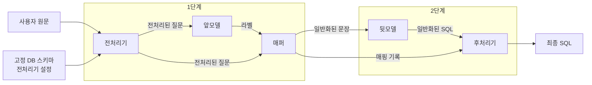

# Text-to-SQL 프로젝트 구조 및 팀원 역할 분담

팀원 2·3·4는 학습에 사용할 질문과 정답을 생성한다. 팀원 2는 일반화된 태그 SQL을 직접 작성하고 SQL 하나에 대응하는 여러 문장 표현을 각각 일반화된 태그 질문으로 만든다. 팀원 3은 질문의 태그를 특정 DB 스키마에 연결하고, 팀원 4는 그 문장 틀을 유지하면서 태그를 자연어 단어나 실제 조건값으로 채운다. 팀원 1은 추론 시 앞모델과 뒷모델을 연결하는 매퍼와 최종 SQL을 복원하는 후처리기를 구현한다.

## 프로젝트 흐름

**추론**



## 프로젝트 구조

현재 구현된 디렉터리와 실험별 체크포인트·GGUF 저장 위치는 [프로젝트 구조 가이드](<./프로젝트 구조 가이드.md>)에서 확인할 수 있다.

추론과 학습은 각각 `inference/`와 `training/`에서 `src/`의 모델 구현을 공유한다. 데이터 생성과 분할은 `src/data_generation/`에서 담당한다. 같은 버전의 앞·뒷모델은 옵션과 데이터셋을 `data/<버전>/`에 함께 둔다. 로컬에서 생성한 데이터셋은 그 안의 `generated/`에 두면 Git에서 제외된다. 기존 뒷모델 옵션 예시는 `data/example/`에 있다. 배포할 때는 두 모델과 대상 DB를 `models/<버전>/`에 모으고, 전처리 사전을 쓰는 버전에는 해당 사전도 포함한다.

```text
.
├── front.py                        # 앞모델 명령 진입점 (구현 예정)
├── back.py                         # 뒷모델 명령 진입점
├── inference/                      # 전처리기 → 앞모델 → 매퍼 → 뒷모델 → 후처리기 호출
├── training/
│   ├── front/                      # 앞모델 학습·검증 실행 코드
│   └── back/                       # 뒷모델 학습·검증 실행 코드
├── src/
│   ├── preprocessor/               # 질문의 스키마 표현을 정규화하고 조건값 원문을 보존
│   ├── front/                      # 앞모델 · 질문 표현을 실제 DB 스키마에 연결
│   ├── mapper/                     # 팀원 1 · 태그 일반화와 복원 기록 생성
│   ├── back/                       # 뒷모델 · 일반화된 태그 질문에서 일반화 SQL 생성
│   ├── postprocessor/              # 팀원 1 · 일반화 SQL을 최종 SQL로 복원
│   └── data_generation/            # 단계별 데이터 생성 스크립트
│       ├── build_front.py          # 앞모델 학습·검증 데이터 구성 (구현 예정)
│       ├── build_back.py           # 뒷모델 질문·SQL 쌍을 학습셋과 검증셋으로 분할
│       ├── generalized_pairs/      # 팀원 2 · 일반화 SQL과 태그 질문 작성
│       │   ├── mappings.json       # 일반화 태그 질문의 표현 변형 후보
│       │   └── generate.py         # 일반화 태그 질문·SQL 쌍 생성
│       ├── schema_mapping/         # 팀원 3 · 태그를 특정 DB 스키마에 매핑
│       │   ├── mappings.json       # 일반화 태그에 배정할 수 있는 대상 DB의 테이블·컬럼 후보
│       │   └── generate.py         # DB 종속 태그 질문과 예시별 이름 대응표 생성
│       └── natural_questions/      # 팀원 4 · 사용자 질문과 대응 라벨 작성
│           ├── mappings.json       # DB 종속 태그에 사용할 자연어 표현과 조건값 후보
│           └── generate.py         # 사용자 질문과 이에 대응하는 앞모델용 정답 생성
├── data/
│   └── v1/                         # 같은 버전의 앞·뒷모델 옵션과 데이터셋 예시
│       ├── front_train_options.json # 앞모델용 학습 옵션 예시
│       ├── back_train_options.json  # 뒷모델용 학습 옵션 예시
│       ├── sql_types.json          # 뒷모델용 데이터 생성 옵션 예시
│       ├── generated/              # Git에서 제외할 로컬 생성 데이터셋
│       ├── front_train.json        # 앞모델용 학습 데이터셋
│       ├── front_validation.json   # 앞모델용 검증 데이터셋
│       ├── front_test.json         # 앞모델용 평가 데이터셋
│       ├── v1_dataset.json         # 뒷모델용 원본 질문·SQL 쌍
│       ├── v1_dataset_back_train.json       # 뒷모델용 학습 데이터셋
│       ├── v1_dataset_back_validation.json  # 뒷모델용 검증 데이터셋
│       ├── back_test.json          # 뒷모델용 독립 평가 데이터셋
│       ├── e2e_test.json           # 전체 파이프라인 평가 데이터셋
│       └── shop.db                 # 스키마 매핑에 사용한 대상 DB
├── models/                         # 버전별 추론 파일과 전체 파이프라인 평가셋
│   └── v1/                         # 하나의 완성 버전 예시
│       ├── front.gguf              # 추론용 앞모델
│       ├── back.gguf               # 추론용 뒷모델
│       ├── shop.db                 # 이 버전의 두 모델과 함께 사용할 DB 사본
│       ├── e2e_test.json           # 전체 파이프라인 평가셋 사본
│       └── normalizer.json         # 선택 사항 · 전처리기가 사용하는 단어 사전
├── tests/                          # 태그 대응, 매퍼·후처리기, 전체 변환 검증
└── docs/                           # 기호 규칙, 학습 데이터 예시, 팀원 역할 분담
```

팀원 2·3·4는 각자 담당 폴더의 `mappings.json`에 데이터 복제·변형에 사용할 후보를 작성한다. 각 `generate.py`는 이 입력을 사용해 단계별 예시를 JSON으로 출력한다. 팀원 2는 직접 작성한 일반화 태그 SQL에서 출발해 뒷모델용 질문·SQL 쌍을 만든다. 팀원 3은 그 질문을 대상 DB 스키마에 매핑하고, 팀원 4는 DB 종속 태그 질문을 바탕으로 사용자 질문과 앞모델용 정답을 만든다.

팀원 2는 데이터 버전 안에서 원본 일반화 SQL마다 고유한 번호를 부여한다. 각 `generate.py`는 부모 ID 뒤에 점과 해당 부모 안에서의 일련번호를 붙여 문자열 `id`를 만든다. 예를 들어 `"1.1.1.2"`는 원본 SQL `"1"`의 첫 번째 태그 질문, 첫 번째 DB 매핑에서 만든 두 번째 사용자 질문이다.

`build_back.py`는 팀원 2의 질문·SQL 쌍을 학습셋과 검증셋으로 나눈다. 같은 정답 SQL을 묻는 질문은 같은 쪽에 배정한다.

전체 파이프라인용 데이터셋을 구성할 때는 원본 SQL을 기준으로 학습·검증·평가 분할을 정하고, 스키마 매핑과 질문 변형에도 같은 분할을 적용한다. 팀원 4의 예시 한 건마다 `id`의 마지막 번호를 하나씩 떼어 대응하는 팀원 3과 팀원 2의 레코드를 찾는다. 예를 들어 `"1.1.1.2"`는 팀원 3의 `"1.1.1"`, 팀원 2의 `"1.1"`에 연결된다. 원본에 배정된 분할의 앞모델 파일에는 사용자 질문을 전처리한 결과와 DB 종속 정답을, 뒷모델 파일의 같은 위치에는 팀원 2의 일반화 질문과 SQL을 저장한다. 팀원 1은 두 파일에서 같은 인덱스의 예시로 매퍼·후처리기를 검증한다.

전체 파이프라인 평가셋을 만들 때는 평가 분할의 원본 태그 SQL에 팀원 3의 스키마 대응표와 팀원 4가 질문에 사용한 조건값을 적용한다. 그 결과가 해당 버전의 `shop.db`에서 실행할 정답 SQL이다. 전처리 전 사용자 질문(`input`)과 최종 정답 SQL(`output`)을 `e2e_test.json`에 저장하며, 예시 순서는 `front_test.json` 및 `back_test.json`과 같다.

특정 원본에서 자연어 질문을 지나치게 많이 생성하면 해당 유형의 학습 비중이 커질 수 있다. 팀원 4는 앞모델용 데이터를 만들 때 의도한 학습 비중에 맞춰 원본별 자연어 표현 수를 조절한다.

### 모델 학습

`training/front/`와 `training/back/`은 각각 `src/front/`와 `src/back/`의 모델을 불러와 학습한다. 학습을 재개하기 위한 중간 체크포인트는 각 학습 작업의 출력 폴더에 둔다. 학습이 끝나면 두 모델을 각각 GGUF 파일로 내보내 대상 DB와 함께 같은 버전 폴더에 저장한다.

| 학습 실행 코드 | 학습 데이터 출처 | 학습·검증 파일 (`data/v1/` 기준) | 모델 입력 → 학습 정답 | 완성 버전 내 저장 위치 예시 |
| --- | --- | --- | --- | --- |
| `training/front/` | 팀원 4의 학습 쌍 | `front_train.json`, `front_validation.json` | 전처리된 사용자 질문 → DB 종속 구간·라벨 객체 **또는** DB 종속 태그 문장 | `models/v1/front.gguf` |
| `training/back/` | 팀원 2의 학습 쌍 | `v1_dataset_back_train.json`, `v1_dataset_back_validation.json` (원본 `v1_dataset.json` 기준) | 일반화된 태그 질문 → 일반화된 태그 SQL | `models/v1/back.gguf` |

팀원 4는 팀원 3이 만든 DB 종속 태그 질문을 바탕으로 앞모델용 데이터를 생성한다. 팀원 1은 같은 예시에서 매퍼가 DB 종속 태그를 팀원 3의 대응표에 따라 일반화하는지 검증한다.

팀원 2·3·4의 현재 담당 범위는 학습 데이터 생성이다. 앞모델과 뒷모델의 학습 담당자는 별도로 정한다.

### 모델 배포와 추론 버전 선택

배포 시 해당 데이터 버전의 전체 파이프라인 평가셋을 모델 버전 폴더에 복사한다. 예를 들어 v1 배포본에는 `data/v1/e2e_test.json`을 그대로 `models/v1/e2e_test.json`에 복사한다.

`inference/`는 실행할 때 버전 하나를 선택한다. 예를 들어 `v1`이면 `models/v1/`에서 `front.gguf`, `back.gguf`, `shop.db`를 불러온다. 단어 사전을 사용하는 경우 전처리기는 같은 폴더의 `normalizer.json`을 읽는다. 모델·DB·사전 중 하나라도 바뀌면 해당 조합을 새 버전 폴더에 보관한다.

## 팀원별 역할과 전달물

| 담당 | 입력 | 맡은 작업과 출력 |
| --- | --- | --- |
| 팀원 1 · 매퍼 | 전처리된 질문과 앞모델의 출력 | 실제 테이블·컬럼에 `TABLEn`·`COLn` 번호를 부여해 뒷모델에 일반화된 질문을 전달한다. 값 번호 `#n`은 유지하고, 각 값 태그와 원문 값의 대응을 후처리기에 전달한다. |
| 팀원 1 · 후처리기 | 뒷모델이 생성한 일반화 SQL과 매퍼의 복원 기록 | 실제 DB 이름과 값을 복원해 최종 SQL을 만든다. 문자열 이스케이프, 날짜 형식 변환, `BETWEEN` 경계 정렬을 이 단계에서 처리한다. |
| 팀원 2 · 일반화된 SQL·질문 쌍 작성 | 합의한 SQL 범위와 기호 규칙 | 일반화된 태그 SQL을 직접 작성한 뒤, 같은 SQL의 뜻을 여러 문장 틀로 표현한다. 각 질문에 해당 식별자와 값 태그를 넣는다. 질문과 SQL을 뒷모델용 학습 쌍으로 보관하고 태그 자연어를 팀원 3에게 전달한다. |
| 팀원 3 · DB 스키마 매핑 | 팀원 2의 태그 자연어와 대상 DB 스키마 | 일반화된 테이블·컬럼을 역할과 타입에 맞는 실제 테이블·컬럼에 연결한다. DB 종속 태그 자연어와 이름 대응표를 팀원 4에게 전달한다. 같은 식별자는 질문 전체에서 같은 컬럼을 가리켜야 한다. |
| 팀원 4 · 사용자 질문 작성 | 팀원 3의 DB 종속 태그 자연어와 이름 대응표 | 팀원 2가 정한 문장 틀을 유지하고, DB 태그를 자연어 표현이나 실제 조건값으로 치환한다. `mappings.json`에서 `{items.item_name, string}`에는 `name`, `item name`, `product name` 등의 표현을, `<items>`에는 `item`, `product` 등의 표현을 문장의 단수·복수에 맞춰 넣는다. `[items.price, numeric, #1]`에는 실제 가격값을 넣는다. 완성된 질문, 대응하는 태그 문장, 값 태그에 채운 원문 값을 함께 보관해 앞모델용 정답과 최종 SQL을 확인할 수 있게 한다. |

## 한 건의 데이터가 완성되는 예시

`shop.db`에서 특정 범주에 속하는 상품 이름을 조회하는 예시다.

| 단계 | 만들어 내는 데이터 |
| --- | --- |
| 팀원 2가 작성한 태그 SQL | `SELECT {TABLE1.COL1, string} FROM <TABLE1> WHERE <TABLE1.COL2, string> = '[TABLE1.COL2, string, #1]'` |
| 팀원 2 → 팀원 3 | `Show the {TABLE1.COL1, string} of <TABLE1> where the <TABLE1.COL2, string> is [TABLE1.COL2, string, #1].` |
| 팀원 3 → 팀원 4 | `Show the {items.item_name, string} of <items> where the <items.category, string> is [items.category, string, #1].` 이름 대응은 `TABLE1 → items`, `COL1 → item_name`, `COL2 → category`다. |
| 팀원 4의 자연어 | `Show the names of products where the category is kitchen.` 여기서 `names`는 `items.item_name`, `products`는 `items`, `kitchen`은 `[items.category, string, #1]`에 대응한다. |
| 최종 SQL 정답 | `SELECT item_name FROM items WHERE category = 'kitchen'` |

이 한 건에서 **뒷모델용 쌍**의 입력은 팀원 2가 작성한 일반화 질문이고 정답은 팀원 2가 작성한 일반화 SQL이다. **앞모델용 파일**(`front_*.json`)의 `input`은 팀원 4의 사용자 질문을 전처리한 문장이다. `output`은 질문 속 표현의 위치와 DB 라벨을 담은 **구간·라벨 객체** 또는 해당 표현을 DB 태그로 치환한 **태그 문장**으로 작성할 수 있다. 어느 형식을 사용할지는 앞모델·매퍼 담당자가 합의한다. 구간·라벨 방식을 선택하면 구간 위치는 전처리된 질문을 기준으로 기록한다.

### 팀원별 `generate.py` 출력 JSON 예시

팀원 2는 특정 속성을 조회하고 숫자 조건 하나로 거르는 SQL을 두 문장 틀로 표현한다. 팀원 3은 조회 속성을 상품명으로 정하고, 첫 번째 질문의 조건 컬럼에는 가격과 재고를 각각 배정한다. 팀원 4는 첫 번째 가격 질문을 복제해 상품명 태그를 각각 `names`와 `item names`로 풀어 쓰고, 가격값에는 10달러와 20달러를 넣는다. 이렇게 복제하면서 예시가 **2건 → 3건 → 4건**으로 늘어난다. 첫 번째 질문의 최종 SQL은 `SELECT item_name FROM items WHERE price > 10`이다.

팀원 2와 4는 각 모델에 넣을 입력을 `input`, 예측할 정답을 `output`으로 기록한다. 팀원 3의 중간 데이터는 매퍼 검증에 맞춰 DB 종속 태그 문장을 `input`, 일반화 태그 문장을 `output`으로 기록한다. 전체 파이프라인용 데이터셋은 계층형 문자열 `id`로 레코드를 연결해 팀원 2·4의 쌍을 각 분할에 저장한다. 전체 평가셋에 쓸 전처리 전 사용자 원문, 스키마 대응표, 조건값은 생성 과정에서 함께 보관한다.

**팀원 2 · 뒷모델 학습 쌍 (`generalized_pairs/generate.py`)**

```json
[
  {
    "id": "1.1",
    "input": "Show the {TABLE1.COL1, string} of <TABLE1> where the <TABLE1.COL2, numeric> is greater than [TABLE1.COL2, numeric, #1].",
    "output": "SELECT {TABLE1.COL1, string} FROM <TABLE1> WHERE <TABLE1.COL2, numeric> > [TABLE1.COL2, numeric, #1]"
  },
  {
    "id": "1.2",
    "input": "List the {TABLE1.COL1, string} of each <TABLE1> with <TABLE1.COL2, numeric> above [TABLE1.COL2, numeric, #1].",
    "output": "SELECT {TABLE1.COL1, string} FROM <TABLE1> WHERE <TABLE1.COL2, numeric> > [TABLE1.COL2, numeric, #1]"
  }
]
```

**팀원 3 · 매퍼 검증 쌍 (`schema_mapping/generate.py`)**

```json
[
  {
    "id": "1.1.1",
    "input": "Show the {items.item_name, string} of <items> where the <items.price, numeric> is greater than [items.price, numeric, #1].",
    "output": "Show the {TABLE1.COL1, string} of <TABLE1> where the <TABLE1.COL2, numeric> is greater than [TABLE1.COL2, numeric, #1]."
  },
  {
    "id": "1.1.2",
    "input": "Show the {items.item_name, string} of <items> where the <items.stock, numeric> is greater than [items.stock, numeric, #1].",
    "output": "Show the {TABLE1.COL1, string} of <TABLE1> where the <TABLE1.COL2, numeric> is greater than [TABLE1.COL2, numeric, #1]."
  },
  {
    "id": "1.2.1",
    "input": "List the {items.item_name, string} of each <items> with <items.price, numeric> above [items.price, numeric, #1].",
    "output": "List the {TABLE1.COL1, string} of each <TABLE1> with <TABLE1.COL2, numeric> above [TABLE1.COL2, numeric, #1]."
  }
]
```

**팀원 4 · 앞모델 학습 쌍 (`natural_questions/generate.py`)**

아래 네 건은 전처리 결과가 원문과 같고, `output`으로 DB 종속 태그 문장을 사용하는 경우다.

```json
[
  {
    "id": "1.1.1.1",
    "input": "Show the names of items where the price is greater than 10 dollars.",
    "output": "Show the {items.item_name, string} of <items> where the <items.price, numeric> is greater than [items.price, numeric, #1]."
  },
  {
    "id": "1.1.1.2",
    "input": "Show the item names of products where the price is greater than 20 dollars.",
    "output": "Show the {items.item_name, string} of <items> where the <items.price, numeric> is greater than [items.price, numeric, #1]."
  },
  {
    "id": "1.1.2.1",
    "input": "Show the names of items where the stock is greater than 5 units.",
    "output": "Show the {items.item_name, string} of <items> where the <items.stock, numeric> is greater than [items.stock, numeric, #1]."
  },
  {
    "id": "1.2.1.1",
    "input": "List the product name of each item with price above 10 dollars.",
    "output": "List the {items.item_name, string} of each <items> with <items.price, numeric> above [items.price, numeric, #1]."
  }
]
```

### 팀원 4의 생성 결과로 만드는 앞모델 JSON 예시

예시 `"1.1.1.1"`을 `front_*.json`에 저장할 때도 `input`은 같은 전처리된 사용자 질문이다. 앞모델·매퍼 담당자가 합의한 형식에 따라 `output`은 아래 두 후보 중 하나가 된다.

**구간·라벨 객체** (`start` 포함, `end` 제외)

```json
{
  "input": "Show the names of items where the price is greater than 10 dollars.",
  "output": {
    "table": "<items>",
    "select": [{"mark": "{items.item_name, string}", "start": 9, "end": 14}],
    "column_mentions": [{"mark": "<items.price, numeric>", "start": 34, "end": 39}],
    "values": [{"mark": "[items.price, numeric, #1]", "start": 56, "end": 66}]
  }
}
```

**또는 DB 종속 태그 문장**

```json
{
  "input": "Show the names of items where the price is greater than 10 dollars.",
  "output": "Show the {items.item_name, string} of <items> where the <items.price, numeric> is greater than [items.price, numeric, #1]."
}
```

## 팀원 간 확인 기준

- 팀원 2·3·4는 각자 `mappings.json`에서 어떤 태그나 표현을 복제하고 어떤 후보로 바꿀 수 있는지 일관된 키와 값 형식으로 나타낸다. 팀원 3은 팀원 2의 파일을, 팀원 4는 팀원 3의 파일을 전달받아 치환 규칙과 생성 가능한 표현을 확인한 뒤, 그 결과를 처리하도록 자신의 `generate.py`를 작성한다.
- 팀원 2·3·4는 같은 예시의 SQL, 두 태그 문장, 자연어 질문을 함께 추적할 수 있게 연결한다. 질문을 자연스럽게 바꾼 뒤에도 조회 대상, 조건값, 비교 방향, 조건의 적용 범위가 원래 SQL과 일치해야 한다.
- 팀원 1은 같은 예시의 전처리된 질문과 DB 종속 라벨을 매퍼에 넣어 팀원 2의 일반화 질문과 대응하는지 확인한다. 이어서 일반화 SQL과 복원 기록을 후처리기에 넣어 최종 SQL 정답을 얻는지 확인한다.
- 앞모델이 매퍼에 전달할 출력 형식과 태그 구간 기준은 앞모델·매퍼 담당자가 합의한다. 팀원 4는 합의한 형식에 맞춰 자연어와 라벨의 대응을 제공한다. 세부 표기는 [Text-to-SQL 기호 및 학습 데이터 합의 이슈](Text-to-SQL%20기호%20및%20학습%20데이터%20합의%20이슈.md)를 따른다.
